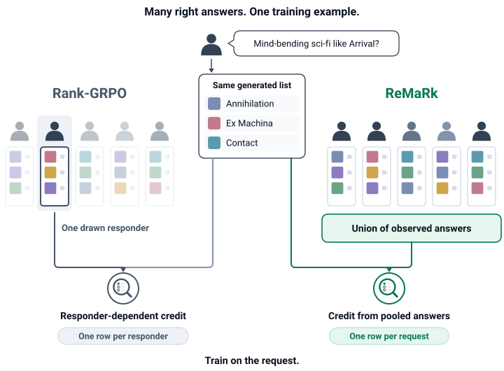
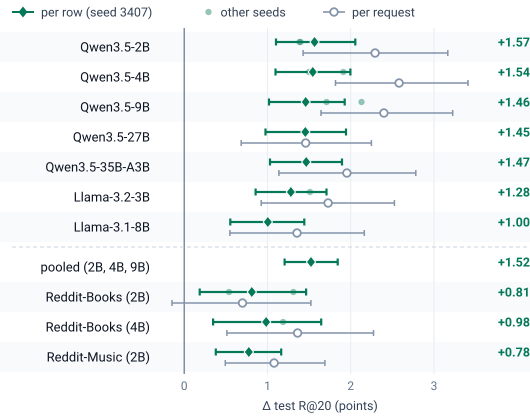

<div align="center">

# ReMaRk

### Many Right Answers, One Training Example: Removing Responder Noise from GRPO for LLM Recommenders

[Xin Li](https://lixin.ai), Hao Jiang, Jinghao Guo, Weisi Lin, Chau Yuen<br>
Nanyang Technological University, Singapore

[](#citation)
[](https://lixin.ai/ReMaRk)
[](https://huggingface.co/collections/XINLI1997/remark-many-right-answers-one-training-example-6acdc1cf30ec71aff2b4bd62)
[](https://huggingface.co/datasets/XINLI1997/ReMaRk-data)
[](LICENSE)
[](data_release/README_data.md)

**When a request has several valid human answers, train on the request, not on each answer.**

</div>

<p align="center">
  <picture>
    <source media="(prefers-color-scheme: dark)" srcset="assets/teaser_dark.svg">
    
  </picture>
</p>

## News

- **2026-10-13** Code, data and 23 checkpoints are public; the [project page](https://lixin.ai/ReMaRk) is online. The arXiv link follows soon.

## The idea in 30 seconds

- **Many right answers.** A Reddit request such as "mind-bending sci-fi like *Arrival*?" gets several replies, and each reply names different titles.
- **The usual recipe adds noise.** Rank-GRPO turns every reply into its own training example, so the reward of a generated list depends on which reply happened to be drawn. That draw explains 85% of the variance of its advantages.
- **ReMaRk: one example per request.** A list earns credit for every title that *any* replier named (union reward), and each request is sampled once. The GRPO update, the model and the budget stay the same.
- **Result.** ReMaRk reaches the validation recall of 2,000 per-reply RL steps in 25–53% of the steps, and leads on test on seven backbones and three datasets.

## Main results

Test Recall@20 (%, per row) after 2,000 RL steps, seed 3407 (Table 2 of the paper). Δ: ReMaRk minus the better per-responder baseline, with a paired-bootstrap 95% CI.

| Dataset | Backbone | SFT | Rank-GRPO | **ReMaRk** | Δ [95% CI] |
|---|---|---:|---:|---:|---|
| Reddit-v2 (movies) | Qwen3.5-2B | 15.40 | 20.97 | **22.53** | +1.57 [1.10, 2.06] |
| | Qwen3.5-4B | 16.53 | 23.56 | **25.10** | +1.54 [1.10, 2.00] |
| | Qwen3.5-9B | 17.23 | 24.05 | **25.51** | +1.46 [1.02, 1.93] |
| | Qwen3.5-27B | 17.90 | 25.17 | **26.62** | +1.45 [0.98, 1.94] |
| | Qwen3.5-35B-A3B | 17.34 | 24.74 | **26.20** | +1.47 [1.03, 1.90] |
| | Llama-3.2-3B | 15.38 | 21.93 | **23.56** | +1.28 [0.86, 1.71] |
| | Llama-3.1-8B | 16.84 | 24.22 | **25.22** | +1.00 [0.55, 1.44] |
| Reddit-Books | Qwen3.5-2B | 20.67 | 29.34 | **30.16** | +0.81 [0.19, 1.46] |
| | Qwen3.5-4B | 21.73 | 30.40 | **31.49** | +0.98 [0.35, 1.64] |
| Reddit-Music | Qwen3.5-2B | 9.31 | 13.40 | **14.48** | +0.78 [0.38, 1.17] |

<details>
<summary>The same gains as a figure (per row, per request and other seeds)</summary>
<p align="center">
  <picture>
    <source media="(prefers-color-scheme: dark)" srcset="assets/results_dark.svg">
    
  </picture>
</p>
</details>

## Quick start

Evaluate a released checkpoint on the Reddit-v2 test set and get one number of the table above (one GPU, Python 3.11, CUDA).

```bash
# 1. Code and environment
git clone https://github.com/LiXin97/ReMaRk && cd ReMaRk
uv venv -p 3.11 .venv && source .venv/bin/activate
uv pip install --override remark/infra/qenv_overrides.txt \
    trl==1.14.0 vllm==0.17.1 deepspeed==0.19.7 accelerate flash-linear-attention==0.5.2 datasets

# 2. Rank-GRPO's title parser and catalog (not redistributed here)
git clone https://github.com/yaochenzhu/Rank-GRPO remark/third_party/Rank-GRPO
git -C remark/third_party/Rank-GRPO checkout 0808d82

# 3. Reddit-v2 test data: download "Reddit-v2 (processed)" from the Rank-GRPO README,
#    then unzip it so that data/raw/reddit_v2/processed_datasets/sft_dataset/ exists
mkdir -p data/raw/reddit_v2 && unzip reddit_v2_processed.zip -d data/raw/reddit_v2

# 4. A released checkpoint (ReMaRk, Qwen3.5-4B, seed 3407)
hf download XINLI1997/ReMaRk-Qwen3.5-4B-RedditV2-ReMaRk-s3407 --local-dir checkpoints/remark-4b

# 5. Evaluate (greedy decoding, 10,972 test rows)
python remark/scripts/crs_eval.py --model checkpoints/remark-4b --name remark_4b_test --split test
```

Expected: `filter_R@20` = 0.2510 in `remark/outputs/crs/remark_4b_test/summary.json` (25.10 in the table).

**Train it yourself.** SFT, then GRPO with the ReMaRk reward on 4 GPUs (2,000 steps, about 384 lists per step):

```bash
remark/node/sft_launch3.sh 0,1,2,3 29500 reddit 2B
DATASET=reddit SEED=3407 remark/node/launch5.sh 0,1,2,3 29500 2B union  group <sft_checkpoint>   # ReMaRk
DATASET=reddit SEED=3407 remark/node/launch5.sh 0,1,2,3 29501 2B single group <sft_checkpoint>   # Rank-GRPO
```

Every other experiment, dataset build, baseline, table and figure is listed in **[docs/REPRODUCE.md](docs/REPRODUCE.md)**.

## Models and data

All on Hugging Face, in the [ReMaRk collection](https://huggingface.co/collections/XINLI1997/remark-many-right-answers-one-training-example-6acdc1cf30ec71aff2b4bd62). "Rank-GRPO" checkpoints are our runs of the baseline in the same pipeline. Each model card names the table row it comes from.

| Dataset | Backbone | SFT start | ReMaRk | Rank-GRPO |
|---|---|---|---|---|
| Reddit-v2 | Qwen3.5-2B | [SFT](https://huggingface.co/XINLI1997/ReMaRk-Qwen3.5-2B-RedditV2-SFT) | [seed 42](https://huggingface.co/XINLI1997/ReMaRk-Qwen3.5-2B-RedditV2-ReMaRk-s42) | [seed 3407](https://huggingface.co/XINLI1997/ReMaRk-Qwen3.5-2B-RedditV2-RankGRPO-s3407) |
| | Qwen3.5-4B | [SFT](https://huggingface.co/XINLI1997/ReMaRk-Qwen3.5-4B-RedditV2-SFT) | [seed 3407](https://huggingface.co/XINLI1997/ReMaRk-Qwen3.5-4B-RedditV2-ReMaRk-s3407) | [seed 3407](https://huggingface.co/XINLI1997/ReMaRk-Qwen3.5-4B-RedditV2-RankGRPO-s3407) |
| | Qwen3.5-9B | [SFT](https://huggingface.co/XINLI1997/ReMaRk-Qwen3.5-9B-RedditV2-SFT) | [seed 3407](https://huggingface.co/XINLI1997/ReMaRk-Qwen3.5-9B-RedditV2-ReMaRk-s3407), [seed 42](https://huggingface.co/XINLI1997/ReMaRk-Qwen3.5-9B-RedditV2-ReMaRk-s42) | [seed 42](https://huggingface.co/XINLI1997/ReMaRk-Qwen3.5-9B-RedditV2-RankGRPO-s42) |
| | Llama-3.2-3B | Rank-GRPO's release | [seed 3407](https://huggingface.co/XINLI1997/Llama-3.2-3B-ReMaRk-RedditV2-ReMaRk-s3407) | [seed 3407](https://huggingface.co/XINLI1997/Llama-3.2-3B-ReMaRk-RedditV2-RankGRPO-s3407) |
| | Llama-3.1-8B | [SFT](https://huggingface.co/XINLI1997/Llama-3.1-8B-ReMaRk-RedditV2-SFT) | [seed 3407](https://huggingface.co/XINLI1997/Llama-3.1-8B-ReMaRk-RedditV2-ReMaRk-s3407) | [seed 3407](https://huggingface.co/XINLI1997/Llama-3.1-8B-ReMaRk-RedditV2-RankGRPO-s3407) |
| Reddit-Books | Qwen3.5-2B | [SFT](https://huggingface.co/XINLI1997/ReMaRk-Qwen3.5-2B-RedditBooks-SFT) | [plateau run](https://huggingface.co/XINLI1997/ReMaRk-Qwen3.5-2B-RedditBooks-ReMaRk-s3407-plateau) | [plateau run](https://huggingface.co/XINLI1997/ReMaRk-Qwen3.5-2B-RedditBooks-RankGRPO-s3407-plateau) |
| | Qwen3.5-4B | | [seed 3407](https://huggingface.co/XINLI1997/ReMaRk-Qwen3.5-4B-RedditBooks-ReMaRk-s3407) | [seed 3407](https://huggingface.co/XINLI1997/ReMaRk-Qwen3.5-4B-RedditBooks-RankGRPO-s3407) |
| Reddit-Music | Qwen3.5-2B | [SFT](https://huggingface.co/XINLI1997/ReMaRk-Qwen3.5-2B-RedditMusic-SFT) | [seed 3407](https://huggingface.co/XINLI1997/ReMaRk-Qwen3.5-2B-RedditMusic-ReMaRk-s3407) | [seed 3407](https://huggingface.co/XINLI1997/ReMaRk-Qwen3.5-2B-RedditMusic-RankGRPO-s3407) |

**Data:** [`XINLI1997/ReMaRk-data`](https://huggingface.co/datasets/XINLI1997/ReMaRk-data) (same files as [`data_release/`](data_release/README_data.md)): requests, responders, item labels, SFT targets and catalogs of Reddit-Books, Reddit-Books-Late and Reddit-Music, as IDs.
Reddit-v2 (movies) is the processed data released with [Rank-GRPO](https://github.com/yaochenzhu/Rank-GRPO).

```python
from datasets import load_dataset
responses = load_dataset("XINLI1997/ReMaRk-data", "books_responses", split="train")
```

## Repository layout

```
remark/lib        reward functions and the Rank-GRPO trainer port (TRL 1.14)
remark/scripts    data building, training, evaluation, baselines, tables and figures
remark/node       launch and queue scripts for GPU nodes
remark/configs    accelerate / DeepSpeed configs, table specs, judge prompts
remark/outputs    aggregate result files behind the paper's tables
data_release      IDs, labels and SFT targets of Reddit-Books, Reddit-Books-Late and Reddit-Music
docs/REPRODUCE.md full reproduction guide
```

## Citation

```bibtex
@misc{li2026remark,
  title  = {Many Right Answers, One Training Example: Removing Responder Noise from GRPO for LLM Recommenders},
  author = {Li, Xin and Jiang, Hao and Guo, Jinghao and Lin, Weisi and Yuen, Chau},
  year   = {2026},
  note   = {Preprint; arXiv link coming soon}
}
```

## License

Code: Apache-2.0 ([LICENSE](LICENSE)). Data in `data_release/` and on Hugging Face: CC BY-NC 4.0. Qwen3.5-based checkpoints follow Apache-2.0; Llama-based checkpoints follow the Llama 3.1 / 3.2 Community License (Built with Llama).

**Not included.** No Reddit post or comment text, prompts or model outputs, and no Goodreads titles (only work ids; titles come from the UCSD Book Graph under its academic-use terms). Book and music labels were extracted by an LLM (GPT-5.6) and grounded to Goodreads / MusicBrainz; SFT targets for these two datasets are GPT-5.6 recommendation lists. Rank-GRPO's code and the Reddit-v2 data come from [its repository](https://github.com/yaochenzhu/Rank-GRPO).
